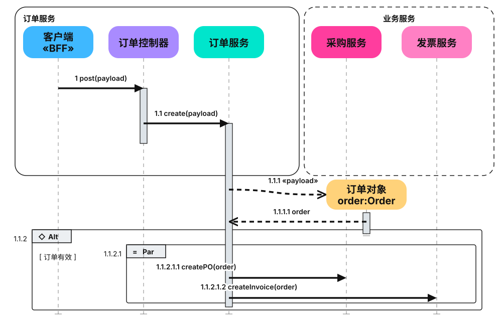
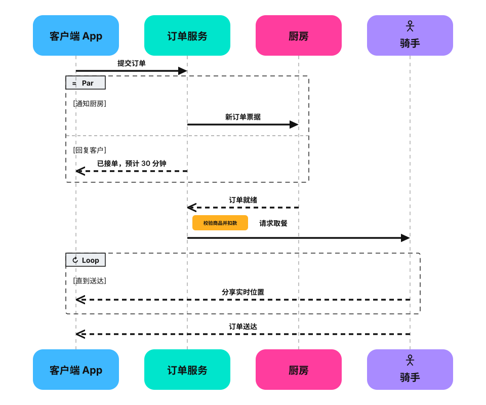
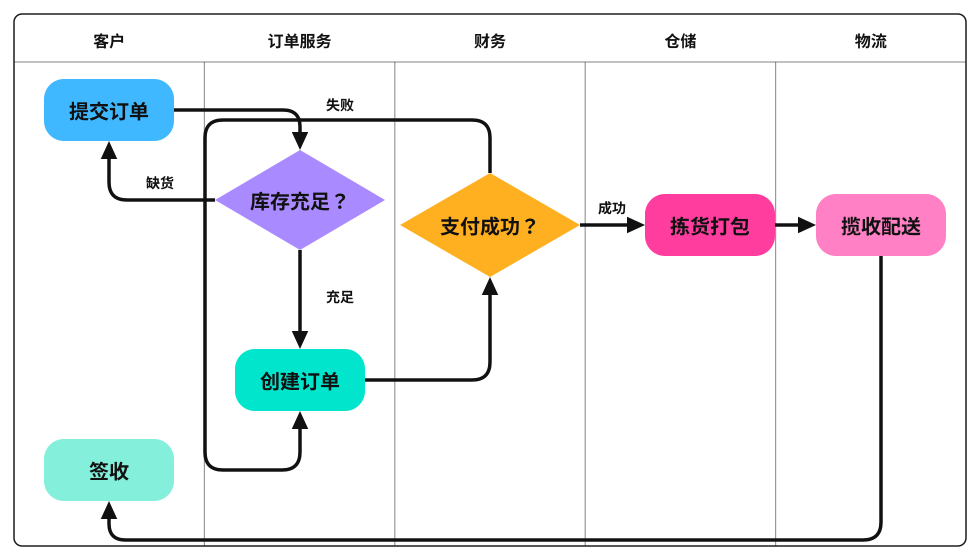
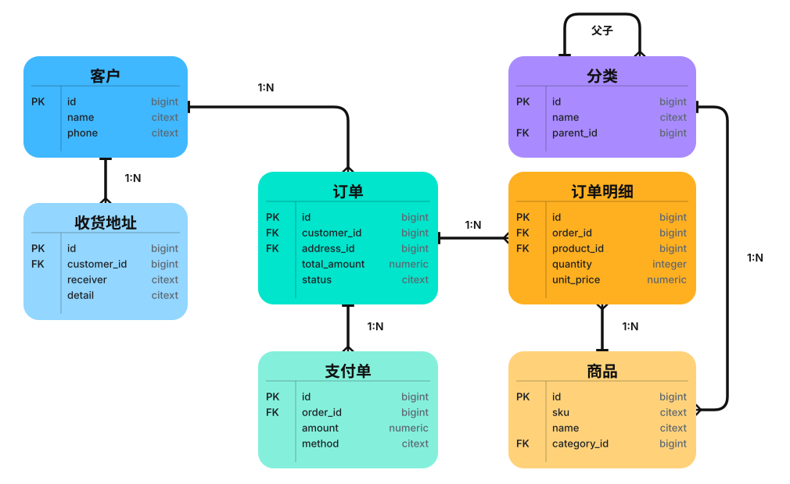
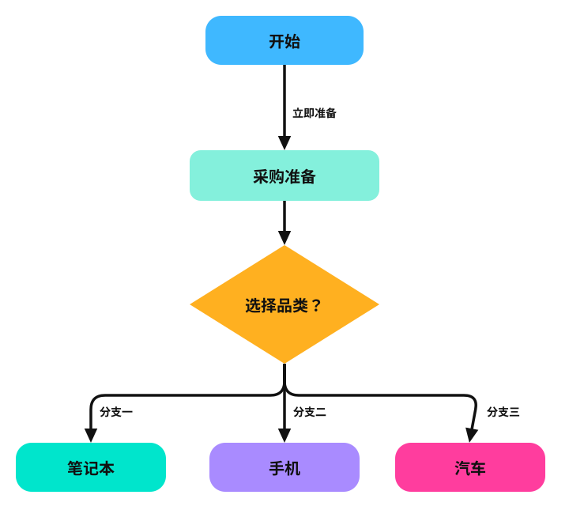

# 通用图解 Demo

内容来源：[brief.md](brief.md)。图稿与独立语义清单：[diagrams.json](diagrams.json)。它们只描述交付与运营关系，不依赖其他仓库的数据、脚本或预览页。

## 看结果

- 发布流水线：横向流程。
  
- 异常恢复闭环：循环、边标签与状态角标。
  
- 订单与仓储边界：嵌套容器、跨服务双向关系、960×540 画布。
  
- 审核分支：椭圆起点、矩形步骤、菱形判断、胶囊状态与 820×450 画布。
  
- 下单时序：生命线加编号消息，请求实线实心箭头（flow）、应答虚线开放箭头（reply），含一次自调用。
  
- 下单时序（进阶）：分组边界（实线左对齐标题 / 虚线）、执行期激活条、运行时创建的对象，外层 Alt（守卫条件 + 框外 op）内嵌 Par，编号沿 op 前缀嵌套。
  
- 外卖履约时序（脚注框与分区片段）：四位参与者（骑手带 `icon: "actor"`）上下各一个同款盒子——头部 + `lifelines[].foot` 脚注副本，生命线止于脚注框顶；Par 片段用 `sections` 均分两区（守卫 `[通知厨房]` / `[回复客户]`），Loop 片段守卫 `[直到送达]`，片段框统一 `dashed: true`；订单服务生命线旁的 amber 小框是「校验商品并扣款」的自行动作示意。
  
- 巡检架构：节点图标 `icon`（user/clock/queue/database/cloud）与异步消费线型（async）。
  
- 订单状态机：`initial`/`final` 起止圆点，迁移条件标注在边上，终态 muted。
  
- 订单数据模型：标准 ER——实体 rows 三列（键标记/列名/类型），`start: "one"` 短杠贴「一」侧、`many` 鸦脚贴「多」侧。
  
- 审批泳道：泳道泳池（单外框 + 标题带 + 道间分隔线），提交人/审核人/财务三竖道，流程自上而下，跨道横向走线、道内纵向走线。
  
- 订单类图：类盒 `fields`/`methods` 分栏（标签加粗置顶、分栏逐行左对齐），配 `many` 鸦脚与 `compose` 菱形。
  
- 转化漏斗：四个 `shape: "trapezoid"` 居中堆叠，宽度按约 0.76 倍递减使上下边缘连续，value 写量级；阶段间不画箭头，转化率以 notes 标注在间隙中线右侧。
  
- 分层架构：接入/服务/数据三层全宽 group 堆叠，上层依赖下层，数据层带 `database` 图标。
  
- 优先级四象限：2×2 group 铺满画布、十字空隙放轴 notes，每象限一件事、无箭头。
  
- 履约泳道（复杂）：五竖道、双判断菱形、缺货与支付失败双回流、签收跨四道回程。
  
- 电商数据模型（复杂 ER）：七实体七关系，含分类自引用父子关系。
  
- 纵向流程图：竖直链 + 判断菱形 + 三分支共享横轨圆角折弯，分支条件标在下落段旁。
  
- [完整预览](output/preview.html)：内嵌渲染器、检查器、数据与样式，可直接打开，也可通过 HTTP 查看。
- [桌面审图表](output/sheet.png)、[390px 审图表](output/sheet-390.png)、[检查报告](output/report.json)。

十八个 SVG 均内嵌样式，独立打开不加载外部 JS。高密度边界图与四形状图以桌面细读为主要场景；390px 截图用于观察缩放效果，若任务要求手机舒适阅读，应放大 SVG 或针对手机拆图，不能只以几何检查通过代替可读性判断。

`shape-vocabulary` 是 `shape: rect | pill | diamond | ellipse` 的用法示例：菱形只判断分支、椭圆只做起止、胶囊只做状态，且菱形与胶囊的外接框按内接文字区域放大；换用外形的尺寸依据见 [frame-format.md](../references/frame-format.md) 的 Shapes 小节。

## 重现

以下使用全局技能软链接，也可将 `SKILL` 设为任何安装位置。依赖：Python 3、Node ≥ 22 与本机 Chrome/Edge/Chromium；拼图还需 Pillow。

```bash
SKILL="$HOME/.agents/skills/draw-diagram"
OUT="$SKILL/demo/output"
python3 "$SKILL/scripts/render.py" "$SKILL/demo/diagrams.json" --out "$OUT" --widths 1200,390
```

一条命令完成构建、`file://` 截图与拼图；预览自包含，无需 HTTP 服务。

本次实际运行直接用本仓库路径作为 `SKILL`，从技能目录调用构建、截图与导出工具：1200px 和 390px 都报告 18/18 已渲染、错误 0、提示 0、JS 报错无，最新两张审图表已查看；四形状帧另以独立的临时负例集核对过判定（菱形内接不足报「文字溢出」、扁菱形带角标报「角标出框」、外接框相叠而轮廓分离的菱形不报「框重叠」、走线穿过菱形空角不报「穿框」）。该 demo 证明工具与产物独立运行，不代表已测量不同模型遵循提示词的成功率。

## 给 agent 的示例任务

```text
使用 draw-diagram。以该技能 demo/brief.md 为语义来源，画出发布流水线、异常恢复闭环、订单与仓储边界、审核分支、下单时序、下单时序（进阶）、外卖履约时序、巡检架构、订单状态机、订单数据模型、审批泳道、订单类图、转化漏斗、分层架构、优先级四象限十八张图解。
先读取通用技能的流程及按分支需要的参考文件；保留来源中的全部节点、边标签与状态。
审核分支按语义选形状：椭圆做起止、矩形做步骤、菱形做判断、胶囊做状态，尺寸按内接区域预留。
下单时序用时序风格：参与者带生命线，消息按时间编号，请求/应答按 UML 惯例区分 kind（flow 实线实心、reply 虚线开放）；进阶帧再加执行期激活条（activations，嵌套靠 from/to 坐标表达）与 Alt/Par 片段框（fragments，外层 alt 的守卫条件与 op 写在框外左侧、内层 par 的坐标收在外框之内，编号沿 op 前缀嵌套），运行时创建的对象放在右侧中部、只留一小段生命线。
巡检架构按角色给节点加 icon（user/clock/queue/database/cloud）；订单状态机用 initial/final 起止圆点；订单数据模型用标准 ER：实体 rows 三列（键标记/列名/类型），1:N 关系 start one 短杠加 many 鸦脚。
审批泳道用 swimlane 泳池（单外框 + 标题带 + 道间分隔线），道为语义节点，流程自上而下，跨道连线横向、道内连线纵向；分层架构用三个全宽 group 纵向堆叠、上层依赖下层；优先级四象限用 2×2 group 加十字空隙与轴 notes。
订单类图用 fields/methods 分栏（content 与图稿保持一致），配 many 鸦脚与 compose 菱形；转化漏斗用 trapezoid 宽度递减堆叠，value 写量级、阶段间不画箭头、转化率用 notes 标注。
复杂例子：履约泳道用 swimlane 五竖道 + 双菱形 + 双回流；电商数据模型用七个 rows 实体 + 自引用父子关系，两者都要求走线横平竖直、标签落在长线段上。
进阶时序用激活条（activations）与 Alt/Par 片段框（fragments）、嵌套编号与运行中创建的对象；分组边界可用 group 的 dashed 与 titleAlign: left。
脚注时序帧给四位参与者的生命线加 `foot`（生命线止于该 y，并在该 y 画同款参与者盒副本，形成上下对称）；Par 片段用 `sections` 均分两个分区、每区自带走守卫（有 sections 时忽略顶层 guard），片段框统一 `dashed: true`，示意内部动作的小框用 `size: "sm"` + amber 填充且不进 content；骑手这类人为参与者用 `icon: "actor"` 火柴人。
输出到一个独立目录，交付自包含 SVG、预览、检查报告和最新审图表。
以桌面细读为主要展示场景，同时提供 390px 截图并说明窄屏可读性限制。
```

## 单帧速度棘轮

这是技能维护的基准，不是每次绘图的额外步骤。可重复生成两个固定场景：`order`（默认）为「开始 → 提交订单 → 校验库存 → 创建订单 → 发起支付 → 支付结果判断；成功发货、失败关闭订单」，桌面单帧、8 节点/7 边；`oauth2` 为 OAuth2 authorization-code + PKCE (S256) 成功路径，桌面单帧、四参与者（用户/浏览器、客户端、授权服务器、资源服务器），公共客户端且无 client_secret。

OAuth2 范围保留客户端生成 state/code_verifier/code_challenge、浏览器授权请求、用户登录与同意、code+state 经浏览器重定向转交客户端、客户端校验 state 并用 code+code_verifier 兑换 token、授权服务器校验 PKCE 后返回 access_token、Bearer 资源请求与资源返回。区分浏览器重定向、token 交换与资源访问；按 RFC 6749/7636，不扩展 OIDC、refresh token 或错误分支，不以减少协议步骤满足耗时门槛。

标准时序新稿只写 `content.nodes/edges` 和 `diagram: {layout: "sequence"}`，参与者列与消息顺序先对照来源确定；沿用一条 `render.py` 命令与完整验收。上方历史手工/高级 demo 的图稿和产物保持原样。

```bash
python3 "$SKILL/scripts/bench.py" --out /tmp/draw-diagram-benchmark-01
python3 "$SKILL/scripts/bench.py" --scenario oauth2 --out /tmp/draw-diagram-oauth2-benchmark-01
```

需已配置 `opencode-go/deepseek-flash` 的 OMP CLI。输出目录必须全新；默认串行运行 3 个独立会话，保持默认思考配置，任一次进程失败、模型不符、输出检查失败或端到端超过 300 秒，立即停止且退出非零。`--scenario order|oauth2` 选择固定任务；`--runs`、`--model`、`--ceiling` 可调整实验参数，但同模型速度验收保持默认模型、思考配置和 300 秒门槛。

`summary.json` 记录场景、UTC 开始时间、实际墙钟、请求/实际模型以及 `skill_sha256`、`toolchain_sha256`、`prompt_sha256`，便于区分指令、代码与任务变化；阈值按未取整的墙钟比较。各次 `events.jsonl` 为带单调时钟时间戳的调用记录，`sessions/` 与 `stderr.log` 保留会话和错误证据。墙钟包含 OMP 启动、模型思考、工具、审图和最终回复，不用文件 mtime 或子 agent 自报时间替代。

自动检查 `viewports[].items[].geometry` 与 `semantic` 两份结果均已执行、零错误，JS 无错，图稿与交付文件存在；`null` 不能通过。图稿可以位于工作目录或 `out/`，不锁定节点/消息的精确措辞。报告验证、来源忠实度、视觉审阅是三个独立验收项：对照场景请求核对全部业务/协议关系及顺序，并亲自查看每次最终 PNG；自动通过不代表来源语义或视觉通过。三次连续运行只有各项都通过且各次 ≤300 秒才接受。

2026-10-13 下单场景历史连续三次实测 111.839/84.086/93.121 秒，平均 96.349 秒、最慢 111.839 秒。三张 PNG 均已审阅，8 节点/7 边的业务关系完整，几何/语义/JS 零错误、零提示。基准用默认思考配置，包含进程退出；未切换模型或删减验收。

上述下单历史记录不代表标准时序性能。2026-10-13 OAuth2 PDCA：手工基准 955.769 秒、39 轮模型调用、10 次渲染；增加语义输入自动排版后，第一轮虽三次计时低于 300 秒，但一张图省略了 S256 的 Base64URL 变换，因此未接受。补上 RFC 7636 语义核对后，第二轮连续三次 98.816/123.318/51.748 秒，平均 91.294 秒；四参与者、13/11/11 条消息，协议源义与最终 PNG 均已独立审阅，几何/语义/JS 零错误。未切换模型、降低思考配置或减少协议步骤。

排版边界回归：

```bash
python3 -m unittest discover -s "$SKILL/scripts" -p 'test_sequence.py' -v
```

回归覆盖消息时间顺序跨越自调用、非法参与者引用，以及真实渲染中的长自调用、末列自调用、多行标题和数值零。真实渲染用例需 Node ≥22 与本机 Chromium。旧手工 OAuth2 图仍通过原工具链；新版本下单场景另实测 52.614 秒，仍为普通流程图而非时序图。

计时门槛目前覆盖上述两个固定任务及标准时序路径，不外推到高级 Alt/Par、自定义手工布局、复杂泳道或 ER 图，也不保证模型服务的未来延迟。每次修正先保留未通过的证据，全部质量项通过后才接受三次连续计时结果。
