# 通用图解 Demo

内容来源：[brief.md](brief.md)。图稿与独立语义清单：[diagrams.json](diagrams.json)。它们只描述交付与运营关系，不依赖其他仓库的数据、脚本或预览页。

## 看结果

- 发布流水线：横向流程。
  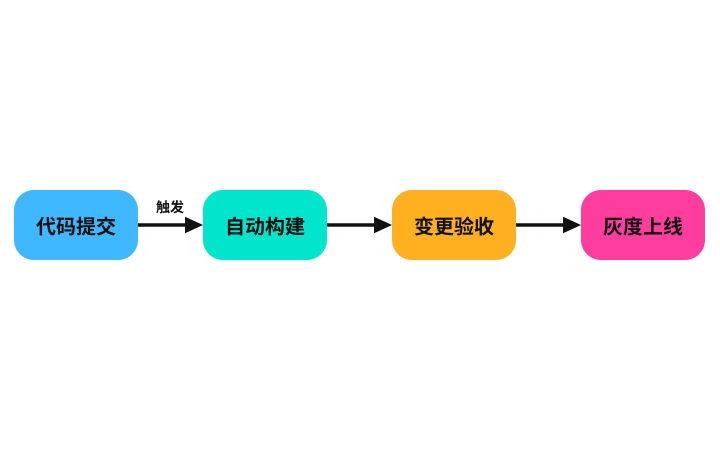
- 异常恢复闭环：循环、边标签与状态角标。
  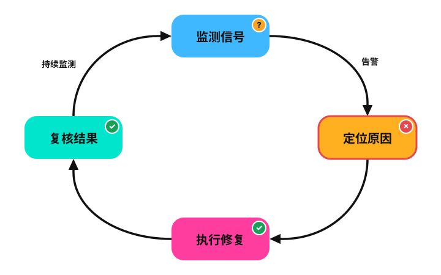
- 订单与仓储边界：嵌套容器、跨服务双向关系、960×540 画布。
  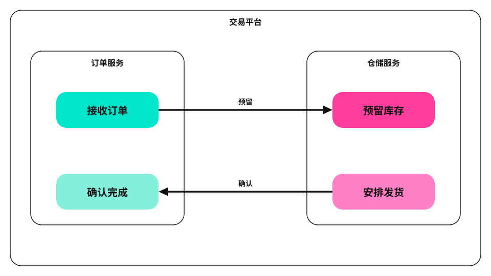
- 审核分支：椭圆起点、矩形步骤、菱形判断、胶囊状态与 820×450 画布。
  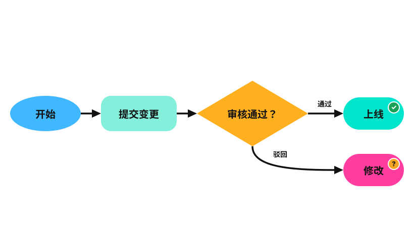
- 下单时序：生命线加编号消息，请求实线实心箭头（flow）、应答虚线开放箭头（reply），含一次自调用。
  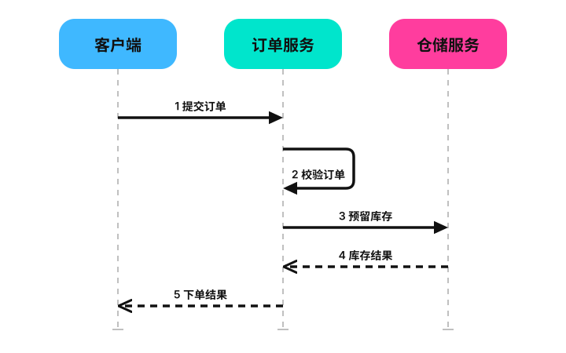
- 巡检架构：节点图标 `icon`（user/clock/queue/database/cloud）与异步消费线型（async）。
  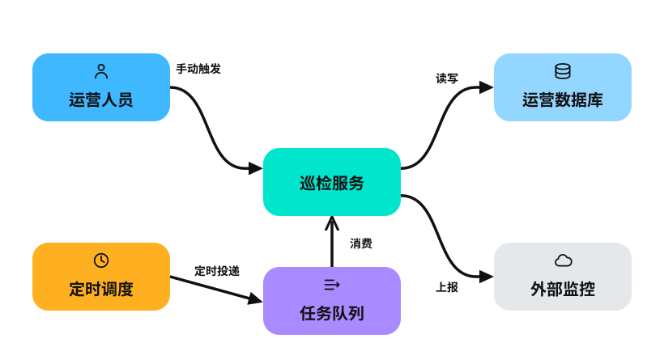
- 订单状态机：`initial`/`final` 起止圆点，迁移条件标注在边上，终态 muted。
  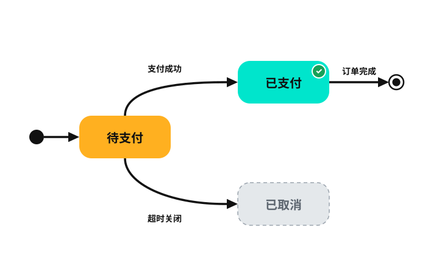
- 订单数据模型：关系端标记——`many` 鸦脚朝多侧，`compose`/`aggregate` 菱形贴整体侧。
  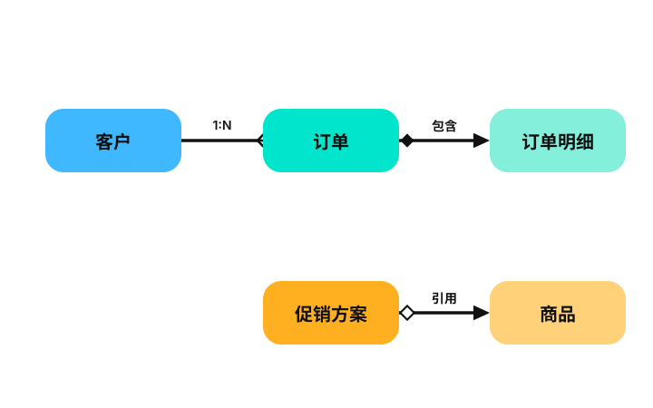
- 审批泳道：三条全宽 group 泳道（提交人/审核人/财务），菱形判断跨道分支，驳回线经右侧回到提交人道。
  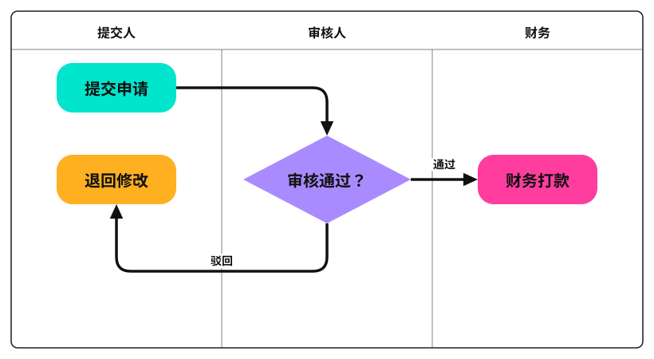
- 订单类图：类盒 `fields`/`methods` 分栏（标签加粗置顶、分栏逐行左对齐），配 `many` 鸦脚与 `compose` 菱形。
  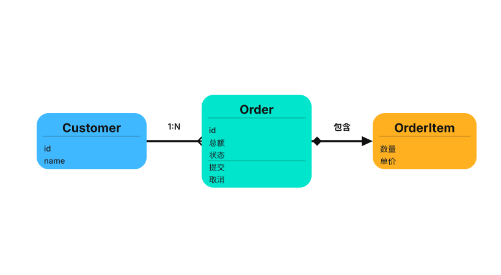
- 转化漏斗：四个 `shape: "trapezoid"` 居中堆叠，宽度按约 0.76 倍递减使上下边缘连续，value 写量级、转化率标在边上。
  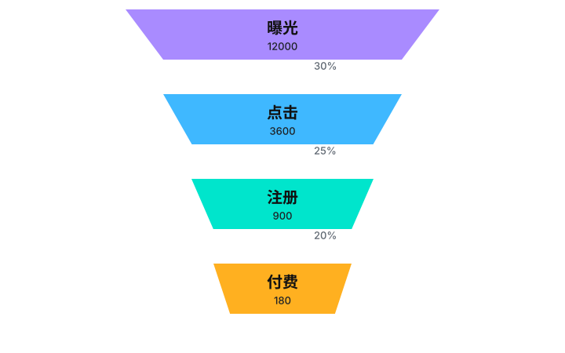
- 分层架构：接入/服务/数据三层全宽 group 堆叠，上层依赖下层，数据层带 `database` 图标。
  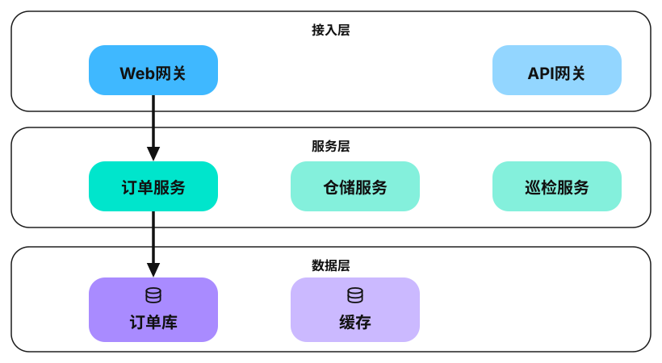
- 优先级四象限：2×2 group 铺满画布、十字空隙放轴 notes，每象限一件事、无箭头。
  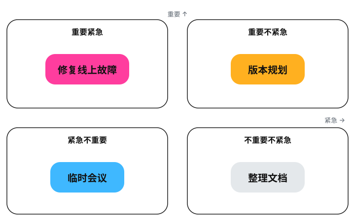
- [完整预览](output/preview.html)：内嵌渲染器、检查器、数据与样式，可直接打开，也可通过 HTTP 查看。
- [桌面审图表](output/sheet.png)、[390px 审图表](output/sheet-390.png)、[检查报告](output/report.json)。

十三个 SVG 均内嵌样式，独立打开不加载外部 JS。高密度边界图与四形状图以桌面细读为主要场景；390px 截图用于观察缩放效果，若任务要求手机舒适阅读，应放大 SVG 或针对手机拆图，不能只以几何检查通过代替可读性判断。

`shape-vocabulary` 是 `shape: rect | pill | diamond | ellipse` 的用法示例：菱形只判断分支、椭圆只做起止、胶囊只做状态，且菱形与胶囊的外接框按内接文字区域放大；换用外形的尺寸依据见 [frame-format.md](../references/frame-format.md) 的 Shapes 小节。

## 重现

以下使用全局技能软链接，也可将 `SKILL` 设为任何安装位置。依赖：Python 3、Node ≥ 22 与本机 Chrome/Edge/Chromium；拼图还需 Pillow。

```bash
SKILL="$HOME/.agents/skills/draw-diagram"
OUT="$SKILL/demo/output"
python3 "$SKILL/scripts/build.py" "$SKILL/demo/diagrams.json" --out "$OUT"
python3 -m http.server 8891 --bind 127.0.0.1 --directory "$OUT"
```

另一个终端执行；服务已存在时直接复用，端口被其他服务占用时选一个可用端口，并同步更改 URL：

```bash
SKILL="$HOME/.agents/skills/draw-diagram"
OUT="$SKILL/demo/output"
node "$SKILL/scripts/shoot.mjs" http://127.0.0.1:8891/preview.html "$OUT"
python3 "$SKILL/scripts/sheet.py" "$OUT"
python3 "$SKILL/scripts/sheet.py" "$OUT" 390
```

本次实际运行直接用本仓库路径作为 `SKILL`，从技能目录调用构建、截图与导出工具：1200px 和 390px 都报告 13/13 已渲染、错误 0、提示 0、JS 报错无，最新两张审图表已查看；四形状帧另以独立的临时负例集核对过判定（菱形内接不足报「文字溢出」、扁菱形带角标报「角标出框」、外接框相叠而轮廓分离的菱形不报「框重叠」、走线穿过菱形空角不报「穿框」）。该 demo 证明工具与产物独立运行，不代表已测量不同模型遵循提示词的成功率。

## 给 agent 的示例任务

```text
使用 draw-diagram。以该技能 demo/brief.md 为语义来源，画出发布流水线、异常恢复闭环、订单与仓储边界、审核分支、下单时序、巡检架构、订单状态机、订单数据模型、审批泳道、订单类图、转化漏斗、分层架构、优先级四象限十三张图解。
先读取通用技能的流程及按分支需要的参考文件；保留来源中的全部节点、边标签与状态。
审核分支按语义选形状：椭圆做起止、矩形做步骤、菱形做判断、胶囊做状态，尺寸按内接区域预留。
下单时序用时序风格：参与者带生命线，消息按时间编号，请求/应答按 UML 惯例区分 kind（flow 实线实心、reply 虚线开放）。
巡检架构按角色给节点加 icon（user/clock/queue/database/cloud）；订单状态机用 initial/final 起止圆点；订单数据模型用 many 鸦脚与 compose/aggregate 菱形。
审批泳道用三条全宽 group 泳道、标题在左、流向跨道；分层架构用三个全宽 group 纵向堆叠、上层依赖下层；优先级四象限用 2×2 group 加十字空隙与轴 notes。
订单类图用 fields/methods 分栏（content 与图稿保持一致），配 many 鸦脚与 compose 菱形；转化漏斗用 trapezoid 宽度递减堆叠，value 写量级、转化率标在边上。
输出到一个独立目录，交付自包含 SVG、预览、检查报告和最新审图表。
以桌面细读为主要展示场景，同时提供 390px 截图并说明窄屏可读性限制。
```
